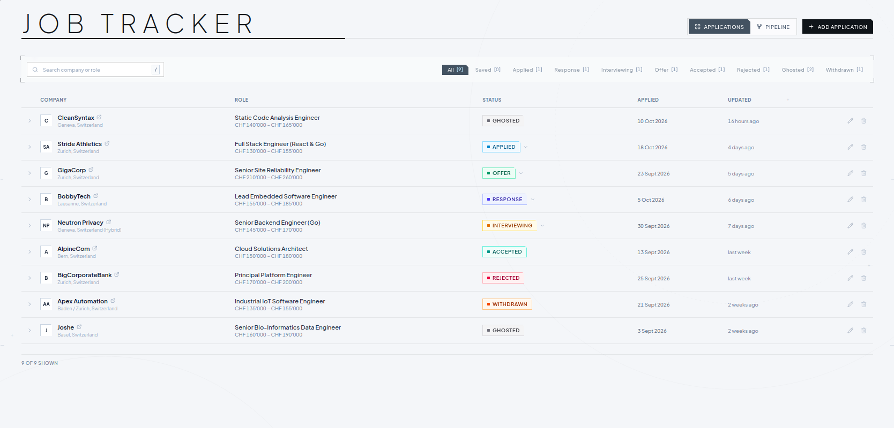
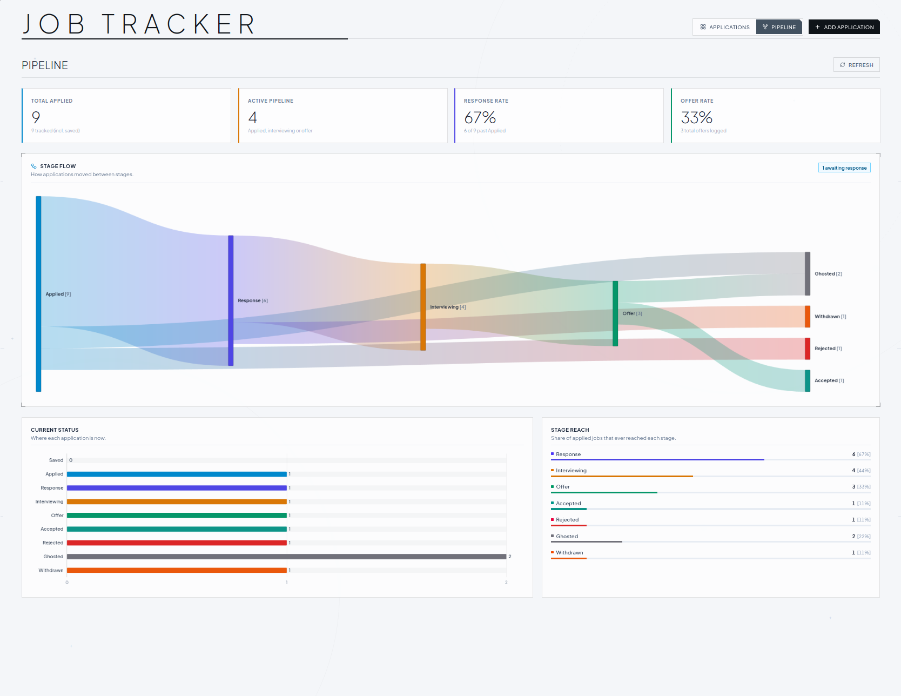

# Job Application Tracker

tldr:
Got bored of having my applications stored in different sites, obsidian got annoying real fast and didn't feel like downloading a ton of plugins so ladida here we are. 

Strongly vibed, you have been warned. 

I was also jealous of all the data sci peeps showing off their application flows on reddit once they got a job so I thought I'd get my own too.

You can get the app up and running with `task dev` that seeds a testdb with some dummy data to get the overall feel, or run "prod" via `task run`.

Will it get prettier? 

Maybe. 

Does it do what it needs to do? 

Yes.

Should I get back to applying for more gigs instead of putting together random dashboards? 

Most definitely.

Have fun.

